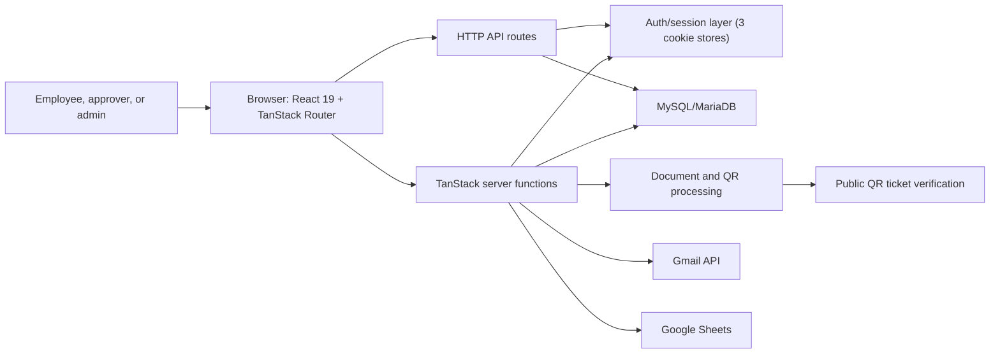
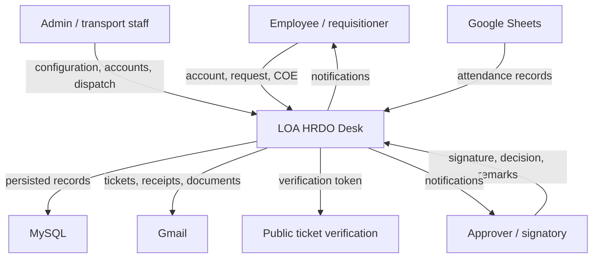
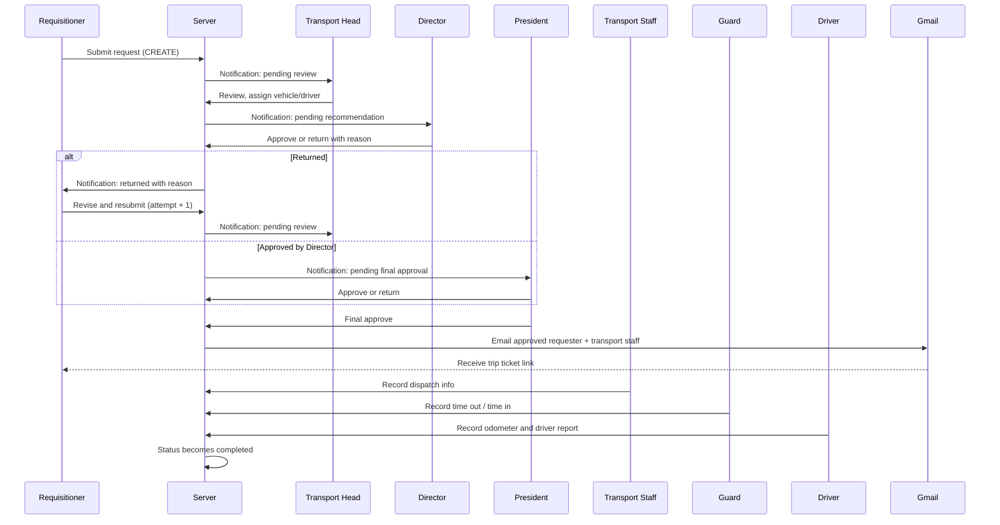
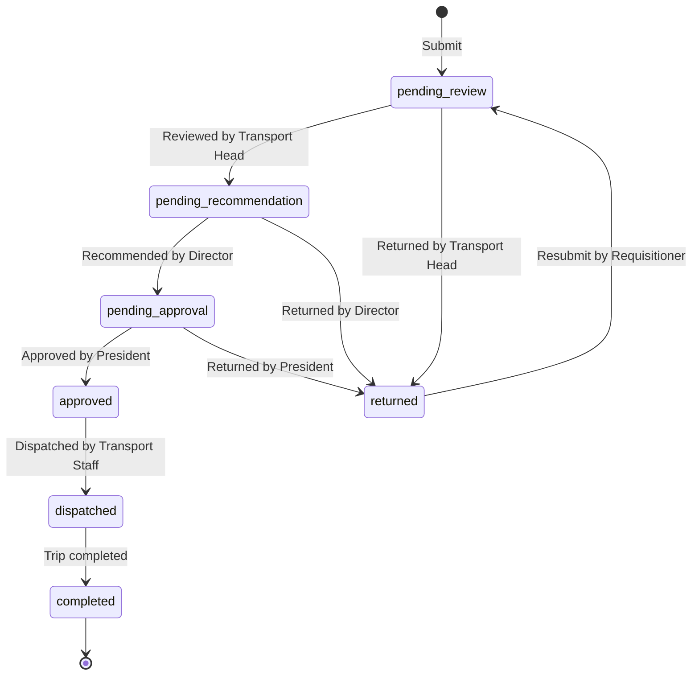
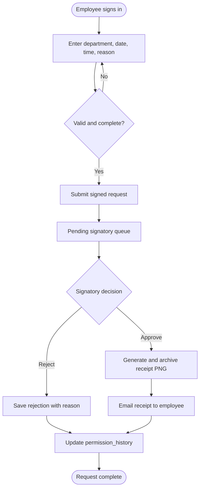
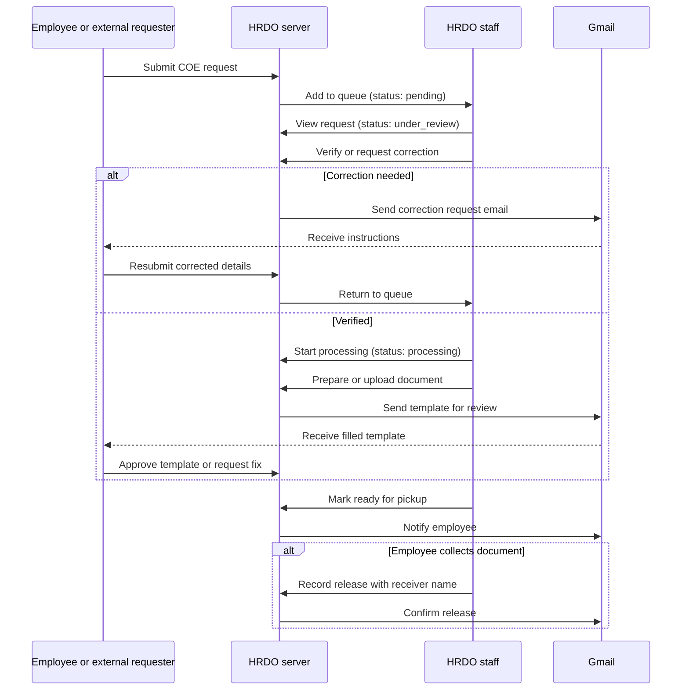
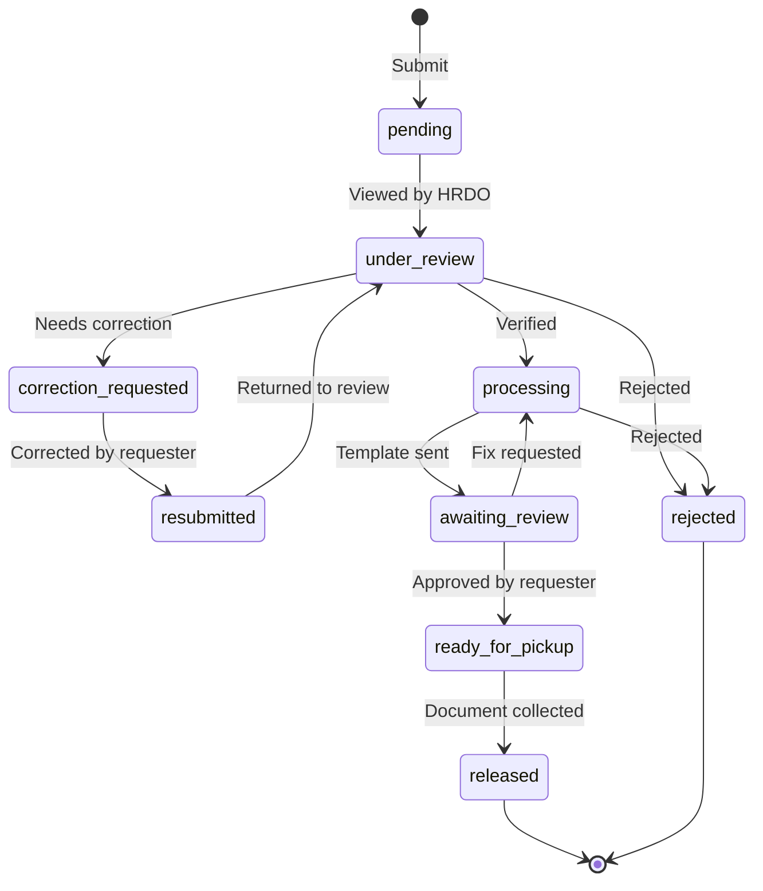
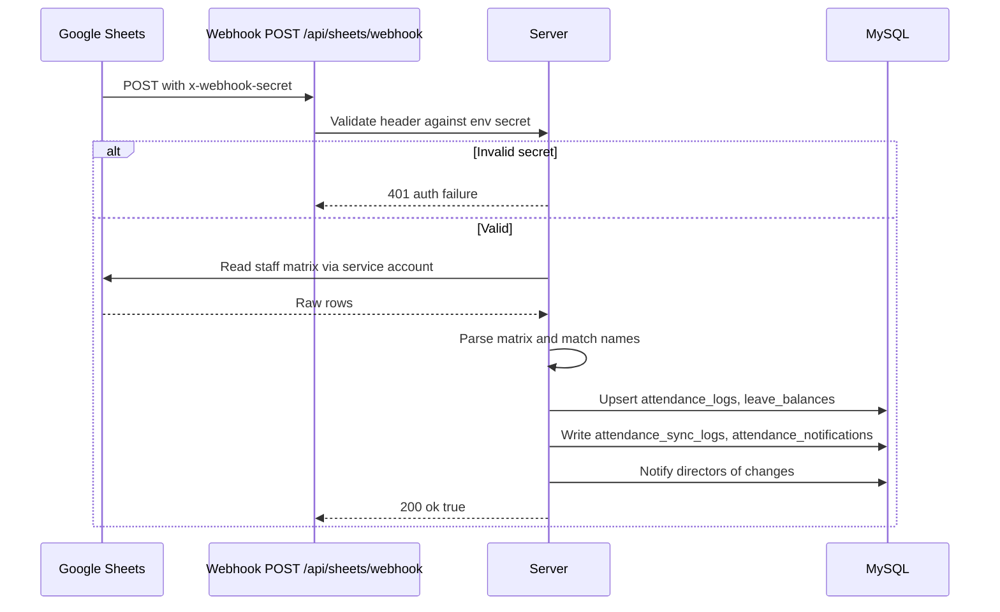

The LOA HRDO Desk is a single TypeScript application built on TanStack Start. Browser pages call server functions that enforce authentication and business rules, read and write a MySQL database, and integrate with Gmail, Google Sheets, and QR generation. This page shows the layer stack, system architecture, data flow diagrams, and detailed workflows for every module.

## Layer stack

| Layer | Implementation |
| --- | --- |
| Browser client | React 19, TanStack Router, TanStack Query, Radix UI, Tailwind CSS |
| Application server | TanStack Start server functions and HTTP routes |
| Language | TypeScript |
| Primary database | MySQL or MariaDB via `mysql2` |
| Validation | Zod schemas and server-side authorization |
| Authentication | Password sessions, OTP registration, Google OAuth, module-specific session stores |
| Integrations | Gmail API, Google Sheets, QR generation, HTML-to-image |
| Testing | Vitest, Testing Library, jsdom |
| Build and development | Vite 8 and Nitro |

## System architecture

The browser is not trusted for authorization. Route guards improve navigation, but every server function re-checks sessions and role permissions before data access or state changes.

### Session and cookie stores

Three independent session tables support the three access paths:

| Cookie name | Table | Scope |
| --- | --- | --- |
| `loa_session` | `sessions` | Main portal and VRTT |
| `loa_hrdo_session` | `hrdo_sessions` | HRDO COE |
| `loa_permission_session` | `permission_sessions` | Permission Slip |

Sessions are random 256-bit tokens stored as SHA-256 hashes, `httpOnly`, `SameSite=Lax`, and `Secure` when `SITE_URL` is HTTPS. All sessions expire after 8 hours.

## Data flow diagrams

### DFD Level 0 (context)

### DFD Level 1 (processes)

```mermaid
flowchart TD
    U["User"] --> P1["P1: Authenticate"]
    P1 --> DS1[("users / hrdo_users")]
    P1 --> DS2[("sessions / hrdo_sessions / permission_sessions")]

    U --> P2["P2: Vehicle requests"]
    P2 --> DS3[("requests")]
    P2 --> DS4[("request_signatures")]
    P2 --> DS5[("request_history")]
    P2 --> DS6[("request_returns")]
    P2 --> DS7[("dispatch_records")]
    P2 --> DS8[("vehicles")]
    P2 --> DS9[("notifications")]
    P2 --> MAIL["Gmail"]
    P2 --> QR["QR verification token"]

    U --> P3["P3: Permission slips"]
    P3 --> DS10[("permission_slips")]
    P3 --> DS11[("permission_slip_signatories")]
    P3 --> DS12[("permission_history")]
    P3 --> MAIL

    U --> P4["P4: COE processing"]
    P4 --> DS13[("hrdo_coe_requests")]
    P4 --> DS14[("hrdo_coe_documents")]
    P4 --> DS15[("hrdo_coe_history")]
    P4 --> MAIL

    U --> P5["P5: Attendance sync"]
    S["Google Sheets"] --> P5
    P5 --> DS16[("sheet_sources")]
    P5 --> DS17[("employee_sheet_mappings")]
    P5 --> DS18[("attendance_logs")]
    P5 --> DS19[("leave_balances")]
    P5 --> DS20[("leave_discrepancy_flags")]

    U --> P6["P6: Notifications"]
    P6 --> DS9
    P6 --> DS21[("attendance_notifications")]
```

## Vehicle Reservation and Trip Ticket workflow

### VRTT approval sequence

Return requires a reason of at least 5 characters. Resubmission increments `attempt`, restarts at the Head of Transport Services, and leaves old signatures on the previous attempt. Requisitioners can edit only before the Head of Transport signs. Approved tickets carry a QR verification link verified at `/api/verify-ticket/$token` with HMAC-SHA256 signed base64url claims.

### VRTT status state diagram

Real statuses and their labels:

| Status | Label |
| --- | --- |
| `pending_review` | Awaiting Transport Review |
| `pending_recommendation` | Awaiting Recommendation |
| `pending_approval` | Awaiting Final Approval |
| `returned` | Returned |
| `approved` | Approved |
| `dispatched` | Dispatched |
| `completed` | Trip Completed |

## Permission Slip workflow

### Permission Slip activity flow

Permission Slip roles: `employee` and `director`. Accounts assigned in `permission_slip_signatories` receive the `director` role and can approve or reject. Only Super Admins manage signatories. Module admins and Super Admins can view the queue read-only without approval power. Reason length is 5 to 500 characters. Receipts are generated as PNGs, archived in `receipt_image`, and emailed to the employee in Philippine 12-hour notation.

## Certificate of Employment workflow

### COE sequence diagram

### COE status state diagram

Real COE statuses and labels:

| Status | Staff label | Requestor label |
| --- | --- | --- |
| `pending` | New | Submitted |
| `under_review` | Under review | Under review |
| `correction_requested` | Correction requested | Needs action |
| `processing` | Under processing | Processing |
| `awaiting_review` | Awaiting requestor review | Awaiting your review |
| `ready_for_pickup` | Ready for pickup | Ready for pickup |
| `released` | Released | Released |
| `rejected` | Rejected | Not approved |

HRDO policy: `COE_PROCESSING_DAYS = 3`. The deadline is fixed at submission and never reset by a correction. `COE_DUE_SOON_HOURS = 24` marks requests approaching deadline.

## Late/Absences sync workflow

### Sheets webhook and sync sequence

The server accepts a `POST /api/sheets/webhook` with the `x-webhook-secret` header. Three staff groups are supported: `NON_TEACHING`, `COLLEGE`, and `BASIC_ED`, each with its own spreadsheet ID from environment variables (`LATE_ABSENCES_*_SPREADSHEET_ID`). The sync parses the Google Sheets staff matrix, maps sheet names to users by surname-first matching, and upserts `attendance_logs` and `leave_balances`. Directors and affected employees receive `attendance_notifications`. Employees can raise `leave_discrepancy_flags` that HR resolves through `/admin/late-absences`.

Attendance codes include: `S` (Sick Leave), `V` (Vacation Leave), `E` (Emergency Leave), `B` (Birthday Leave), `M` (Maternity Leave), `P` (Paternity Leave), `SP` (Solo Parent Leave), `SIL` (Service Incentive Leave), `HS` (Half-Day Sick), `HV` (Half-Day Vacation), `HE` (Half-Day Emergency), `L` and `LATE` (Late Entry). The cycle runs June to May with a base allocation of 17 leave days.
