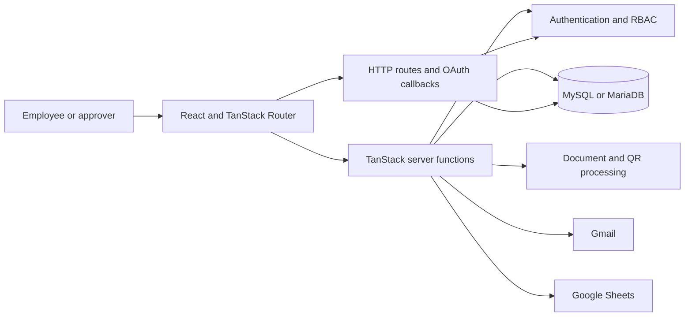
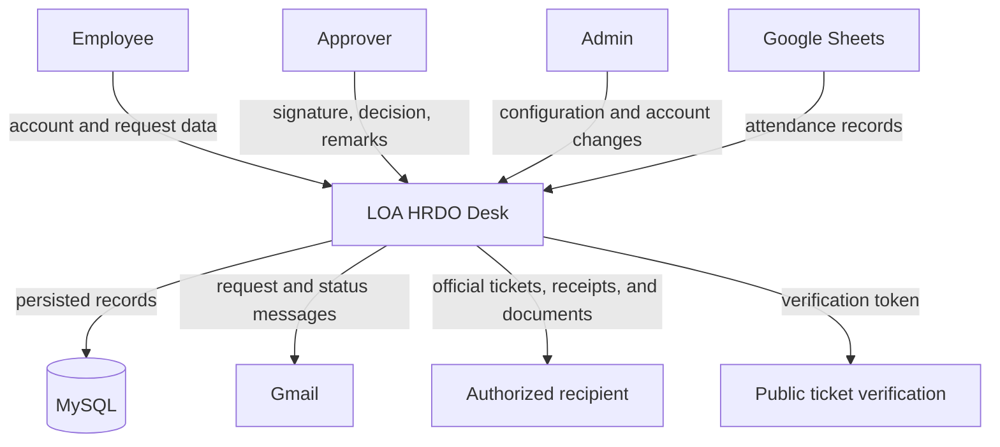
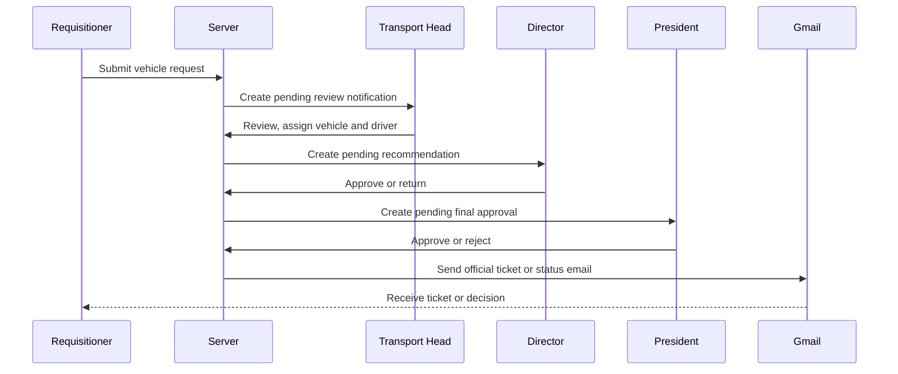
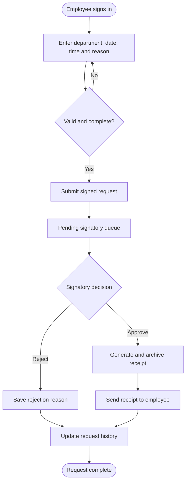
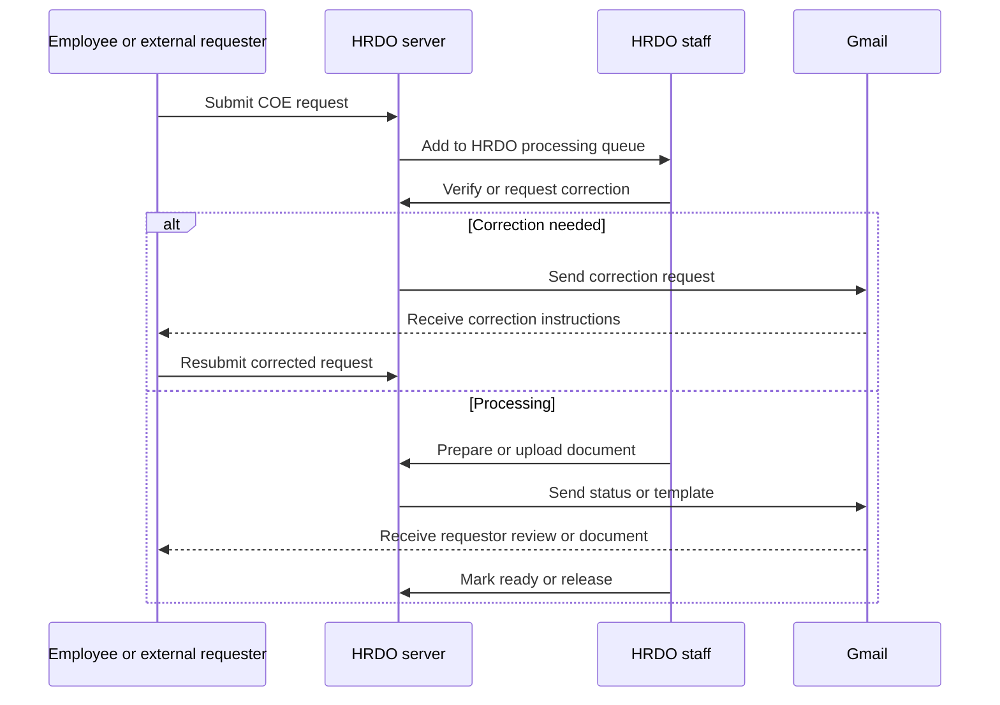

# Architecture

| Layer | Implementation |
| --- | --- |
| Browser client | React 19, TanStack Router, TanStack Query, Radix UI components, Tailwind CSS |
| Application server | TanStack Start server functions and HTTP routes |
| Language | TypeScript |
| Primary database | MySQL or MariaDB through `mysql2` |
| Validation | Zod schemas and server-side authorization |
| Authentication | Password sessions, OTP registration, Google OAuth, and dedicated module sessions |
| Integrations | Gmail, Google Sheets, QR generation, HTML-to-image |
| Testing | Vitest, Testing Library, jsdom |
| Build and development | Vite and Nitro |

## Component structure

The browser is not trusted for authorization. Route guards improve navigation, while server functions re-check sessions and role permissions before data access or state changes.

# Data flow

# Vehicle approval sequence

# Permission Slip activity

# COE activity

