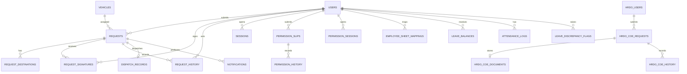

# Database environment

The primary datastore is MySQL or MariaDB. Schema setup is implemented in `scripts/schema.sql`, and database setup and seed operations are in `scripts/setup-db.mjs` and `scripts/seed-accounts.mjs`.

# Entity relationship overview

# Shared account and session tables

| Table | Purpose |
| --- | --- |
| `users` | Main institutional account identity, role, department, profile state, and lockout fields. |
| `sessions` | Main application login sessions and SHA-256 token hashes. |
| `registration_otps` | Pending institutional-account registration verification records. |
| `permission_slip_admins` | Permission Slip module administrator assignments. |
| `permission_slip_signatories` | Permission Slip approval signatory assignments. |
| `permission_sessions` | Dedicated Permission Slip module sessions. |
| `system_access_history` | Super administrator grants and revocations. |

The system stores passwords as scrypt hashes. Session records contain token hashes, not reusable plaintext password or session secrets.

# Vehicle request tables

| Table | Purpose |
| --- | --- |
| `requests` | Trip request details, status, attempt number, and assigned vehicle. |
| `request_sequences` | Year-based official ticket numbering. |
| `request_destinations` | Ordered destination list for each request. |
| `request_signatures` | Electronic signatures for each approval stage and attempt. |
| `request_history` | Submission, update, decision, dispatch, and completion events. |
| `request_returns` | Return decisions and reasons at each approval stage. |
| `dispatch_records` | Time out, time in, odometer, completion, and dispatch details. |
| `vehicles` | Fleet types, plate numbers, driver names, and service status. |
| `notifications` | Inbox and workflow email status for request actions. |
| `notification_attachments` | Inline or downloadable official trip-ticket images. |
| `analytics_pageviews` | Basic page-view event data for analytics. |

Important constraints include unique request numbers, destination cascade deletion, vehicle foreign-key handling, passenger limits, date consistency, attempt limits, and stage enum values.

# Permission Slip tables

| Table | Purpose |
| --- | --- |
| `permission_slips` | Employee snapshot, department, schedule, reason, signatures, status, decision, and receipt. |
| `permission_history` | Submission, approval, and rejection history. |
| `permission_slip_admins` | Module administrator assignments. |
| `permission_slip_signatories` | Assigned approval signatories. |
| `permission_sessions` | Dedicated Permission Slip authentication sessions. |

The receipt image is stored as a MEDIUMBLOB for approved slips so receipt delivery can use the archived image.

# COE tables

| Table | Purpose |
| --- | --- |
| `hrdo_users` | Internal employee, processor, and HRDO administrator accounts. |
| `hrdo_sessions` | HRDO module session records. |
| `hrdo_registration_otps` | Internal HRDO account registration OTP records. |
| `hrdo_coe_requests` | Request purpose, copy type, status, deadline, and processing data. |
| `hrdo_coe_documents` | Uploaded or finalized document content and metadata. |
| `hrdo_coe_history` | Submitted, viewed, verified, processed, released, and rejected events. |

# Attendance and document tables

| Table | Purpose |
| --- | --- |
| `leave_balances` | Staff-group allocation and remaining leave credits. |
| `attendance_logs` | Employee date, code, leave type, and credited days. |
| `leave_discrepancy_flags` | Employee discrepancies and HR resolution replies. |
| `attendance_notifications` | Synced-record and discrepancy notifications. |
| `attendance_sync_logs` | Google Sheets sync run status and results. |
| `sheet_sources` | Staff-group spreadsheet source configuration. |
| `employee_sheet_mappings` | Application user to spreadsheet employee identity. |
| `doc_config` | Institution and trip-document configuration. |
| `signatory_assistants` | Alternate signatory names and account IDs. |
| `main_signatory_assignments` | Main signatory assignment by approval stage. |

# Integrity practices

- UUID primary keys are used for application records.
- Foreign keys protect ownership and cascade or restrict as appropriate.
- Unique constraints prevent duplicate users, vehicles, mappings, and signatory assignments.
- Indexes support user history, status queues, deadlines, destinations, and notification lookup.
- Transactions are used for dependent database operations.
- Zod schemas validate API input before server operations.
