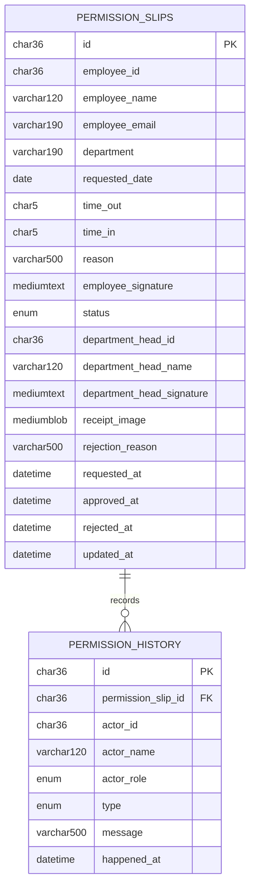
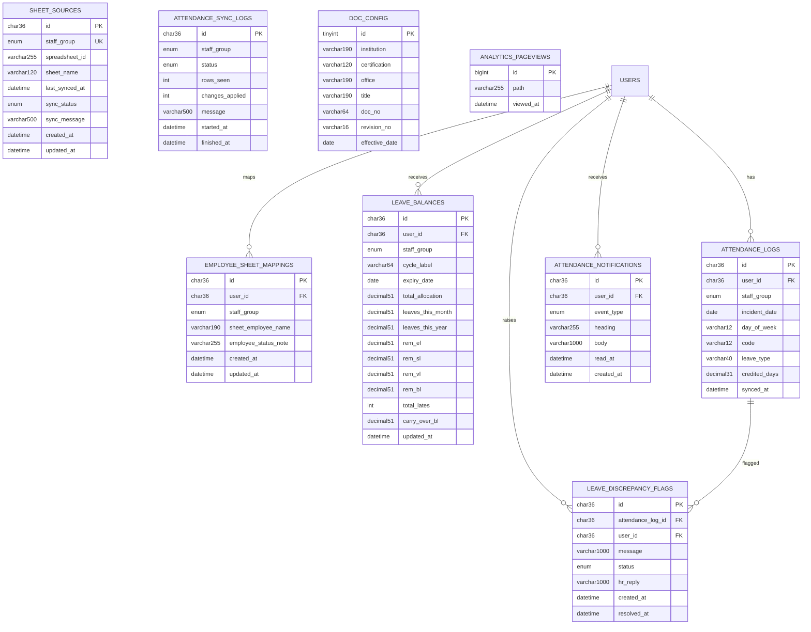

The primary datastore is MySQL (or MariaDB), accessed via `mysql2`. Schema setup is implemented in `scripts/schema.sql`. Setup and seed operations are handled by `scripts/setup-db.mjs` and `scripts/seed-accounts.mjs`.

## Overview

- **Engine:** InnoDB
- **Charset:** `utf8mb4` with `utf8mb4_unicode_ci` collation
- **Primary keys:** `CHAR(36)` UUIDs for application tables; `BIGINT UNSIGNED AUTO_INCREMENT` only for `analytics_pageviews`
- **Foreign keys:** enforced with explicit `ON DELETE` behavior (CASCADE, SET NULL, or RESTRICT)
- **CHECK constraints:** used for numeric ranges, date ordering, single-row config, and enum-like stage values
- **Password storage:** scrypt hashes in `VARCHAR(255)`; session tokens stored as SHA-256 `CHAR(64)` hashes

## Entity Relationship Diagrams

### Core Accounts, Access, and Sessions

```mermaid
erDiagram
    USERS {
        char36 id PK
        varchar120 name
        varchar190 email UK
        varchar32 phone_number
        varchar255 password_hash
        enum role
        varchar190 department
        tinyint must_change_password
        tinyint profile_complete
        tinyint is_super_admin
        int failed_attempts
        datetime locked_until
        datetime created_at
        datetime updated_at
    }
    SESSIONS {
        char36 id PK
        char36 user_id FK
        char64 token_hash UK
        varchar255 user_agent
        datetime created_at
        datetime last_seen_at
        datetime expires_at
    }
    PERMISSION_SESSIONS {
        char36 id PK
        char36 user_id FK
        char64 token_hash UK
        varchar255 user_agent
        datetime created_at
        datetime last_seen_at
        datetime expires_at
    }
    HRDO_USERS {
        char36 id PK
        varchar120 name
        varchar190 email UK
        varchar255 password_hash
        enum role
        tinyint is_external
        varchar190 department
        tinyint must_change_password
        int failed_attempts
        datetime locked_until
        datetime created_at
        datetime updated_at
    }
    HRDO_SESSIONS {
        char36 id PK
        char36 user_id FK
        char64 token_hash UK
        varchar255 user_agent
        datetime created_at
        datetime last_seen_at
        datetime expires_at
    }
    REGISTRATION_OTPS {
        varchar190 email PK
        varchar120 name
        varchar190 department
        varchar255 password_hash
        char64 code_hash
        char36 send_nonce
        tinyint attempts
        datetime last_sent_at
        datetime expires_at
    }
    HRDO_REGISTRATION_OTPS {
        varchar190 email PK
        varchar120 name
        varchar190 department
        varchar255 password_hash
        char64 code_hash
        char36 send_nonce
        tinyint attempts
        datetime last_sent_at
        datetime expires_at
    }
    PERMISSION_SLIP_ADMINS {
        char36 user_id PK FK
        char36 assigned_by FK
        datetime assigned_at
    }
    PERMISSION_SLIP_SIGNATORIES {
        char36 user_id PK FK
        char36 assigned_by FK
        datetime assigned_at
    }
    SYSTEM_ACCESS_HISTORY {
        char36 id PK
        char36 actor_id FK
        varchar120 actor_name
        varchar190 actor_email
        char36 target_id FK
        varchar190 target_email
        enum module_key
        enum role_key
        enum action
        datetime happened_at
    }
    MAIN_SIGNATORY_ASSIGNMENTS {
        varchar16 stage_key PK
        char36 user_id FK UK
    }
    SIGNATORY_ASSISTANTS {
        varchar16 stage_key PK
        varchar120 assistant_name
        char36 assistant_user_id FK
    }

    USERS ||--o{ SESSIONS : opens
    USERS ||--o{ PERMISSION_SESSIONS : opens
    USERS ||--o{ PERMISSION_SLIP_ADMINS : assigned
    USERS ||--o{ PERMISSION_SLIP_SIGNATORIES : assigned
    USERS ||--o{ SYSTEM_ACCESS_HISTORY : acts
    USERS ||--o{ SYSTEM_ACCESS_HISTORY : targeted
    USERS ||--o{ MAIN_SIGNATORY_ASSIGNMENTS : assigned
    USERS ||--o{ SIGNATORY_ASSISTANTS : assigned
    HRDO_USERS ||--o{ HRDO_SESSIONS : opens
```

### Vehicle Requests and Workflow

```mermaid
erDiagram
    REQUESTS {
        char36 id PK
        varchar32 number UK
        char36 requisitioner_id FK
        varchar120 requisitioner_name
        varchar190 department
        int passengers
        date date_start
        date date_end
        char5 time_needed
        text purpose
        enum status
        int attempt
        char36 vehicle_id FK
        varchar80 vehicle_type
        varchar32 plate_no
        text review_remarks
        datetime approved_at
        datetime created_at
        datetime submitted_at
    }
    REQUEST_DESTINATIONS {
        char36 request_id PK FK
        int sort_order PK
        varchar200 destination
    }
    REQUEST_SIGNATURES {
        char36 id PK
        char36 request_id FK
        enum stage
        int attempt
        char36 signer_id FK
        varchar120 signer_name
        enum signer_role
        varchar120 proxy_signer_name
        mediumtext image
        enum method
        text remarks
        datetime signed_at
    }
    REQUEST_HISTORY {
        char36 id PK
        char36 request_id FK
        int attempt
        char36 actor_id FK
        varchar120 actor_name
        enum actor_role
        enum type
        varchar500 message
        text reason
        datetime happened_at
    }
    REQUEST_RETURNS {
        char36 id PK
        char36 request_id FK
        enum stage
        char36 by_id FK
        varchar120 by_name
        enum by_role
        text reason
        int attempt
        datetime returned_at
    }
    DISPATCH_RECORDS {
        char36 request_id PK FK
        varchar120 dispatched_by
        datetime time_out
        datetime time_in
        varchar120 user_signature_name
        int odometer_start
        int odometer_end
        text driver_report
        varchar120 driver_name
        datetime completed_at
    }
    VEHICLES {
        char36 id PK
        varchar120 driver_name
        varchar80 type
        varchar32 plate_no UK
        enum status
        datetime created_at
    }
    REQUEST_SEQUENCES {
        smallint year PK
        int last_number
    }
    NOTIFICATIONS {
        char36 id PK
        char36 request_id FK
        char36 to_user_id FK
        varchar120 to_name
        varchar190 to_email
        varchar255 subject
        enum kind
        enum stage
        varchar255 heading
        text body
        varchar80 cta_label
        datetime read_at
        enum email_status
        varchar500 email_error
        datetime created_at
    }
    NOTIFICATION_ATTACHMENTS {
        char36 notification_id PK FK
        varchar32 mime
        mediumblob image
    }

    USERS ||--o{ REQUESTS : submits
    USERS ||--o{ REQUEST_SIGNATURES : signs
    USERS ||--o{ REQUEST_HISTORY : acts
    USERS ||--o{ REQUEST_RETURNS : returns
    REQUESTS ||--o{ REQUEST_DESTINATIONS : has
    REQUESTS ||--o{ REQUEST_SIGNATURES : receives
    REQUESTS ||--o{ REQUEST_HISTORY : records
    REQUESTS ||--o{ REQUEST_RETURNS : receives
    REQUESTS ||--o| DISPATCH_RECORDS : dispatches
    REQUESTS ||--o{ NOTIFICATIONS : produces
    VEHICLES ||--o{ REQUESTS : assigned
    NOTIFICATIONS ||--o| NOTIFICATION_ATTACHMENTS : attaches
```

### Permission Slips



### COE and HRDO

```mermaid
erDiagram
    HRDO_COE_REQUESTS {
        char36 id PK
        char36 employee_id FK
        varchar120 employee_name
        varchar190 employee_email
        varchar40 employee_number
        varchar190 department
        varchar255 purpose
        text note
        enum copy_type
        enum status
        text remarks
        text correction_message
        datetime deadline_at
        datetime verified_at
        varchar120 verified_by_name
        datetime correction_requested_at
        datetime finalized_at
        datetime ready_at
        datetime released_at
        varchar120 released_by_name
        varchar120 received_by_name
        varchar255 email_thread_id
        char36 processed_by_id
        varchar120 processed_by_name
        datetime requested_at
        datetime updated_at
    }
    HRDO_COE_DOCUMENTS {
        char36 request_id PK FK
        varchar255 file_name
        varchar255 mime
        int size_bytes
        mediumblob content
        char36 uploaded_by_id
        varchar120 uploaded_by_name
        datetime uploaded_at
    }
    HRDO_COE_HISTORY {
        char36 id PK
        char36 request_id FK
        varchar120 actor_name
        enum actor_role
        enum type
        varchar500 message
        datetime happened_at
    }

    HRDO_USERS ||--o{ HRDO_COE_REQUESTS : submits
    HRDO_COE_REQUESTS ||--o| HRDO_COE_DOCUMENTS : stores
    HRDO_COE_REQUESTS ||--o{ HRDO_COE_HISTORY : records
```

### Attendance and Document Configuration



## Table Reference

### Core Accounts and Access

#### `users`

Main institutional account identity. Stores role, department, profile state, password lockout, and super-admin flag.

| Column | Type | Null | Default | Key/Constraint |
| --- | --- | --- | --- | --- |
| id | CHAR(36) | NO |  | PRIMARY KEY |
| name | VARCHAR(120) | NO |  |  |
| email | VARCHAR(190) | NO |  | UNIQUE KEY |
| phone_number | VARCHAR(32) | YES | NULL |  |
| password_hash | VARCHAR(255) | NO |  |  |
| role | ENUM | NO |  |  |
| department | VARCHAR(190) | NO | '' |  |
| must_change_password | TINYINT(1) | NO | 0 |  |
| profile_complete | TINYINT(1) | NO | 1 |  |
| is_super_admin | TINYINT(1) | NO | 0 |  |
| failed_attempts | INT | NO | 0 |  |
| locked_until | DATETIME | YES | NULL |  |
| created_at | DATETIME | NO | CURRENT_TIMESTAMP |  |
| updated_at | DATETIME | NO | CURRENT_TIMESTAMP ON UPDATE CURRENT_TIMESTAMP |  |

**Indexes and constraints:** `users_email_uq` (email), `users_super_admin_idx` (is_super_admin, id).

#### `sessions`

Main application login sessions. Token hashes are SHA-256, not plaintext secrets.

| Column | Type | Null | Default | Key/Constraint |
| --- | --- | --- | --- | --- |
| id | CHAR(36) | NO |  | PRIMARY KEY |
| user_id | CHAR(36) | NO |  | FOREIGN KEY `sessions_user_fk` ON DELETE CASCADE |
| token_hash | CHAR(64) | NO |  | UNIQUE KEY |
| user_agent | VARCHAR(255) | NO | '' |  |
| created_at | DATETIME | NO | CURRENT_TIMESTAMP |  |
| last_seen_at | DATETIME | NO | CURRENT_TIMESTAMP |  |
| expires_at | DATETIME | NO |  |  |

**Indexes:** `sessions_token_uq` (token_hash), `sessions_token_last_seen_idx` (token_hash, last_seen_at), `sessions_user_idx` (user_id), `sessions_expiry_idx` (expires_at).

#### `permission_sessions`

Dedicated Permission Slip module sessions with the same token-hash pattern.

| Column | Type | Null | Default | Key/Constraint |
| --- | --- | --- | --- | --- |
| id | CHAR(36) | NO |  | PRIMARY KEY |
| user_id | CHAR(36) | NO |  | FOREIGN KEY `permission_sessions_user_fk` ON DELETE CASCADE |
| token_hash | CHAR(64) | NO |  | UNIQUE KEY |
| user_agent | VARCHAR(255) | NO | '' |  |
| created_at | DATETIME | NO | CURRENT_TIMESTAMP |  |
| last_seen_at | DATETIME | NO | CURRENT_TIMESTAMP |  |
| expires_at | DATETIME | NO |  |  |

**Indexes:** `permission_sessions_token_uq` (token_hash), `permission_sessions_user_idx` (user_id), `permission_sessions_expiry_idx` (expires_at).

#### `permission_slip_admins`

Permission Slip module administrator assignments.

| Column | Type | Null | Default | Key/Constraint |
| --- | --- | --- | --- | --- |
| user_id | CHAR(36) | NO |  | PRIMARY KEY, FOREIGN KEY `permission_slip_admin_user_fk` ON DELETE CASCADE |
| assigned_by | CHAR(36) | YES | NULL | FOREIGN KEY `permission_slip_admin_actor_fk` ON DELETE SET NULL |
| assigned_at | DATETIME | NO | CURRENT_TIMESTAMP |  |

#### `permission_slip_signatories`

Permission Slip approval signatory assignments.

| Column | Type | Null | Default | Key/Constraint |
| --- | --- | --- | --- | --- |
| user_id | CHAR(36) | NO |  | PRIMARY KEY, FOREIGN KEY `permission_slip_signatory_user_fk` ON DELETE CASCADE |
| assigned_by | CHAR(36) | YES | NULL | FOREIGN KEY `permission_slip_signatory_actor_fk` ON DELETE SET NULL |
| assigned_at | DATETIME | NO | CURRENT_TIMESTAMP |  |

#### `system_access_history`

Audit log for Super Admin grants and revocations.

| Column | Type | Null | Default | Key/Constraint |
| --- | --- | --- | --- | --- |
| id | CHAR(36) | NO |  | PRIMARY KEY |
| actor_id | CHAR(36) | YES | NULL | FOREIGN KEY `system_access_history_actor_fk` ON DELETE SET NULL |
| actor_name | VARCHAR(120) | NO |  |  |
| actor_email | VARCHAR(190) | NO |  |  |
| target_id | CHAR(36) | YES | NULL | FOREIGN KEY `system_access_history_target_fk` ON DELETE SET NULL |
| target_email | VARCHAR(190) | NO |  |  |
| module_key | ENUM | NO |  |  |
| role_key | ENUM | NO |  |  |
| action | ENUM | NO |  |  |
| happened_at | DATETIME | NO | CURRENT_TIMESTAMP |  |

**Indexes:** `system_access_history_time_idx` (happened_at), `system_access_history_target_idx` (target_email, happened_at).

#### `main_signatory_assignments`

Main signatory assignment by approval stage (review, recommend, approve). One row per stage.

| Column | Type | Null | Default | Key/Constraint |
| --- | --- | --- | --- | --- |
| stage_key | VARCHAR(16) | NO |  | PRIMARY KEY, CHECK `main_signatory_assignments_stage_ck` |
| user_id | CHAR(36) | NO |  | FOREIGN KEY `main_signatory_assignments_user_fk` ON DELETE CASCADE, UNIQUE KEY |

**Constraints:** `stage_key` must be in `('review','recommend','approve')`.

#### `signatory_assistants`

Alternate signatory names and optional account IDs per stage.

| Column | Type | Null | Default | Key/Constraint |
| --- | --- | --- | --- | --- |
| stage_key | VARCHAR(16) | NO |  | PRIMARY KEY, CHECK `signatory_assistants_stage_ck` |
| assistant_name | VARCHAR(120) | NO |  |  |
| assistant_user_id | CHAR(36) | YES | NULL | FOREIGN KEY `signatory_assistants_user_fk` ON DELETE SET NULL |

**Constraints:** `stage_key` must be in `('review','recommend','approve')`.

#### `registration_otps`

Pending institutional-account registration verification records.

| Column | Type | Null | Default | Key/Constraint |
| --- | --- | --- | --- | --- |
| email | VARCHAR(190) | NO |  | PRIMARY KEY |
| name | VARCHAR(120) | NO |  |  |
| department | VARCHAR(190) | NO |  |  |
| password_hash | VARCHAR(255) | NO |  |  |
| code_hash | CHAR(64) | NO |  |  |
| send_nonce | CHAR(36) | NO |  |  |
| attempts | TINYINT UNSIGNED | NO | 0 |  |
| last_sent_at | DATETIME | NO |  |  |
| expires_at | DATETIME | NO |  |  |

**Indexes:** `registration_otps_expiry_idx` (expires_at).

### Vehicle Requests and Workflow

#### `requests`

Trip request details, status, attempt number, and assigned vehicle.

| Column | Type | Null | Default | Key/Constraint |
| --- | --- | --- | --- | --- |
| id | CHAR(36) | NO |  | PRIMARY KEY |
| number | VARCHAR(32) | NO |  | UNIQUE KEY |
| requisitioner_id | CHAR(36) | NO |  | FOREIGN KEY `requests_requisitioner_fk` ON DELETE RESTRICT |
| requisitioner_name | VARCHAR(120) | NO |  |  |
| department | VARCHAR(190) | NO |  |  |
| passengers | INT | NO |  | CHECK `requests_passengers_ck` |
| date_start | DATE | NO |  |  |
| date_end | DATE | NO |  | CHECK `requests_dates_ck` |
| time_needed | CHAR(5) | NO |  |  |
| purpose | TEXT | NO |  |  |
| status | ENUM | NO | pending_review |  |
| attempt | INT | NO | 1 | CHECK `requests_attempt_ck` |
| vehicle_id | CHAR(36) | YES | NULL | FOREIGN KEY `requests_vehicle_fk` ON DELETE SET NULL |
| vehicle_type | VARCHAR(80) | YES | NULL |  |
| plate_no | VARCHAR(32) | YES | NULL |  |
| review_remarks | TEXT | YES | NULL |  |
| approved_at | DATETIME | YES | NULL |  |
| created_at | DATETIME | NO | CURRENT_TIMESTAMP |  |
| submitted_at | DATETIME | NO | CURRENT_TIMESTAMP |  |

**Indexes:** `requests_number_uq` (number), `requests_requisitioner_idx` (requisitioner_id, submitted_at), `requests_status_idx` (status), `requests_status_date_idx` (status, date_start, submitted_at), `requests_date_submitted_idx` (date_start, submitted_at), `requests_vehicle_idx` (vehicle_id).

**Constraints:** passengers between 1 and 200; date_end >= date_start; attempt >= 1.

#### `request_destinations`

Ordered destination list for each request. Composite primary key.

| Column | Type | Null | Default | Key/Constraint |
| --- | --- | --- | --- | --- |
| request_id | CHAR(36) | NO |  | PRIMARY KEY, FOREIGN KEY `request_destinations_fk` ON DELETE CASCADE |
| sort_order | INT | NO |  | PRIMARY KEY |
| destination | VARCHAR(200) | NO |  |  |

#### `request_signatures`

Electronic signatures for each approval stage and attempt.

| Column | Type | Null | Default | Key/Constraint |
| --- | --- | --- | --- | --- |
| id | CHAR(36) | NO |  | PRIMARY KEY |
| request_id | CHAR(36) | NO |  | FOREIGN KEY `request_signatures_request_fk` ON DELETE CASCADE |
| stage | ENUM | NO |  |  |
| attempt | INT | NO |  |  |
| signer_id | CHAR(36) | YES | NULL | FOREIGN KEY `request_signatures_signer_fk` ON DELETE SET NULL |
| signer_name | VARCHAR(120) | NO |  |  |
| signer_role | ENUM | NO |  |  |
| proxy_signer_name | VARCHAR(120) | YES | NULL |  |
| image | MEDIUMTEXT | YES | NULL |  |
| method | ENUM | NO |  |  |
| remarks | TEXT | YES | NULL |  |
| signed_at | DATETIME | NO |  |  |

**Indexes:** `request_signatures_request_idx` (request_id, attempt).

#### `request_history`

Submission, update, decision, dispatch, and completion events.

| Column | Type | Null | Default | Key/Constraint |
| --- | --- | --- | --- | --- |
| id | CHAR(36) | NO |  | PRIMARY KEY |
| request_id | CHAR(36) | NO |  | FOREIGN KEY `request_history_request_fk` ON DELETE CASCADE |
| attempt | INT | NO |  |  |
| actor_id | CHAR(36) | YES | NULL | FOREIGN KEY `request_history_actor_fk` ON DELETE SET NULL |
| actor_name | VARCHAR(120) | NO |  |  |
| actor_role | ENUM | NO |  |  |
| type | ENUM | NO |  |  |
| message | VARCHAR(500) | NO |  |  |
| reason | TEXT | YES | NULL |  |
| happened_at | DATETIME | NO |  |  |

**Indexes:** `request_history_request_idx` (request_id, happened_at).

#### `request_returns`

Return decisions and reasons at each approval stage.

| Column | Type | Null | Default | Key/Constraint |
| --- | --- | --- | --- | --- |
| id | CHAR(36) | NO |  | PRIMARY KEY |
| request_id | CHAR(36) | NO |  | FOREIGN KEY `request_returns_request_fk` ON DELETE CASCADE |
| stage | ENUM | NO |  |  |
| by_id | CHAR(36) | YES | NULL | FOREIGN KEY `request_returns_actor_fk` ON DELETE SET NULL |
| by_name | VARCHAR(120) | NO |  |  |
| by_role | ENUM | NO |  |  |
| reason | TEXT | NO |  |  |
| attempt | INT | NO |  |  |
| returned_at | DATETIME | NO |  |  |

**Indexes:** `request_returns_request_idx` (request_id, returned_at).

#### `dispatch_records`

Time out, time in, odometer, completion, and dispatch details.

| Column | Type | Null | Default | Key/Constraint |
| --- | --- | --- | --- | --- |
| request_id | CHAR(36) | NO |  | PRIMARY KEY, FOREIGN KEY `dispatch_records_request_fk` ON DELETE CASCADE |
| dispatched_by | VARCHAR(120) | YES | NULL |  |
| time_out | DATETIME | YES | NULL |  |
| time_in | DATETIME | YES | NULL |  |
| user_signature_name | VARCHAR(120) | YES | NULL |  |
| odometer_start | INT | YES | NULL |  |
| odometer_end | INT | YES | NULL |  |
| driver_report | TEXT | YES | NULL |  |
| driver_name | VARCHAR(120) | YES | NULL |  |
| completed_at | DATETIME | YES | NULL |  |

#### `vehicles`

Fleet types, plate numbers, driver names, and service status.

| Column | Type | Null | Default | Key/Constraint |
| --- | --- | --- | --- | --- |
| id | CHAR(36) | NO |  | PRIMARY KEY |
| driver_name | VARCHAR(120) | NO |  |  |
| type | VARCHAR(80) | NO |  |  |
| plate_no | VARCHAR(32) | NO |  | UNIQUE KEY |
| status | ENUM | NO | in_service |  |
| created_at | DATETIME | NO | CURRENT_TIMESTAMP |  |

**Indexes:** `vehicles_plate_uq` (plate_no).

#### `request_sequences`

Year-based official ticket numbering.

| Column | Type | Null | Default | Key/Constraint |
| --- | --- | --- | --- | --- |
| year | SMALLINT | NO |  | PRIMARY KEY |
| last_number | INT | NO | 0 |  |

#### `notifications`

Inbox and workflow email status for request actions.

| Column | Type | Null | Default | Key/Constraint |
| --- | --- | --- | --- | --- |
| id | CHAR(36) | NO |  | PRIMARY KEY |
| request_id | CHAR(36) | NO |  | FOREIGN KEY `notifications_request_fk` ON DELETE CASCADE |
| to_user_id | CHAR(36) | NO |  | FOREIGN KEY `notifications_user_fk` ON DELETE CASCADE |
| to_name | VARCHAR(120) | NO |  |  |
| to_email | VARCHAR(190) | NO |  |  |
| subject | VARCHAR(255) | NO |  |  |
| kind | ENUM | NO |  |  |
| stage | ENUM | YES | NULL |  |
| heading | VARCHAR(255) | NO |  |  |
| body | TEXT | NO |  |  |
| cta_label | VARCHAR(80) | NO |  |  |
| read_at | DATETIME | YES | NULL |  |
| email_status | ENUM | YES | NULL |  |
| email_error | VARCHAR(500) | YES | NULL |  |
| created_at | DATETIME | NO | CURRENT_TIMESTAMP |  |

**Indexes:** `notifications_inbox_idx` (to_user_id, created_at), `notifications_request_idx` (request_id).

#### `notification_attachments`

Inline or downloadable official trip-ticket images.

| Column | Type | Null | Default | Key/Constraint |
| --- | --- | --- | --- | --- |
| notification_id | CHAR(36) | NO |  | PRIMARY KEY, FOREIGN KEY `notification_attachments_fk` ON DELETE CASCADE |
| mime | VARCHAR(32) | NO | image/png |  |
| image | MEDIUMBLOB | NO |  |  |

### Permission Slips

#### `permission_slips`

Employee snapshot, department, schedule, reason, signatures, status, decision, and receipt.

| Column | Type | Null | Default | Key/Constraint |
| --- | --- | --- | --- | --- |
| id | CHAR(36) | NO |  | PRIMARY KEY |
| employee_id | CHAR(36) | NO |  |  |
| employee_name | VARCHAR(120) | NO |  |  |
| employee_email | VARCHAR(190) | NO |  |  |
| department | VARCHAR(190) | NO |  |  |
| requested_date | DATE | NO |  |  |
| time_out | CHAR(5) | NO |  |  |
| time_in | CHAR(5) | NO |  |  |
| reason | VARCHAR(500) | NO |  |  |
| employee_signature | MEDIUMTEXT | NO |  |  |
| status | ENUM | NO | pending_approval |  |
| department_head_id | CHAR(36) | YES | NULL |  |
| department_head_name | VARCHAR(120) | YES | NULL |  |
| department_head_signature | MEDIUMTEXT | YES | NULL |  |
| receipt_image | MEDIUMBLOB | YES | NULL |  |
| rejection_reason | VARCHAR(500) | YES | NULL |  |
| requested_at | DATETIME | NO | CURRENT_TIMESTAMP |  |
| approved_at | DATETIME | YES | NULL |  |
| rejected_at | DATETIME | YES | NULL |  |
| updated_at | DATETIME | NO | CURRENT_TIMESTAMP ON UPDATE CURRENT_TIMESTAMP |  |

**Indexes:** `permission_employee_idx` (employee_id, requested_at), `permission_employee_email_idx` (employee_email, requested_at), `permission_status_idx` (status, department).

#### `permission_history`

Submission, approval, and rejection history.

| Column | Type | Null | Default | Key/Constraint |
| --- | --- | --- | --- | --- |
| id | CHAR(36) | NO |  | PRIMARY KEY |
| permission_slip_id | CHAR(36) | NO |  | FOREIGN KEY `permission_history_slip_fk` ON DELETE CASCADE |
| actor_id | CHAR(36) | YES | NULL |  |
| actor_name | VARCHAR(120) | NO |  |  |
| actor_role | ENUM | NO |  |  |
| type | ENUM | NO |  |  |
| message | VARCHAR(500) | NO |  |  |
| happened_at | DATETIME | NO | CURRENT_TIMESTAMP |  |

**Indexes:** `permission_history_idx` (permission_slip_id, happened_at).

### COE and HRDO

#### `hrdo_users`

Internal employee, processor, and HRDO administrator accounts. External flag restricts access to COE-only pages.

| Column | Type | Null | Default | Key/Constraint |
| --- | --- | --- | --- | --- |
| id | CHAR(36) | NO |  | PRIMARY KEY |
| name | VARCHAR(120) | NO |  |  |
| email | VARCHAR(190) | NO |  | UNIQUE KEY |
| password_hash | VARCHAR(255) | NO |  |  |
| role | ENUM | NO | employee |  |
| is_external | TINYINT(1) | NO | 0 |  |
| department | VARCHAR(190) | NO | '' |  |
| must_change_password | TINYINT(1) | NO | 0 |  |
| failed_attempts | INT | NO | 0 |  |
| locked_until | DATETIME | YES | NULL |  |
| created_at | DATETIME | NO | CURRENT_TIMESTAMP |  |
| updated_at | DATETIME | NO | CURRENT_TIMESTAMP ON UPDATE CURRENT_TIMESTAMP |  |

**Indexes:** `hrdo_users_email_uq` (email).

#### `hrdo_sessions`

HRDO module session records with the same token-hash pattern.

| Column | Type | Null | Default | Key/Constraint |
| --- | --- | --- | --- | --- |
| id | CHAR(36) | NO |  | PRIMARY KEY |
| user_id | CHAR(36) | NO |  | FOREIGN KEY `hrdo_sessions_user_fk` ON DELETE CASCADE |
| token_hash | CHAR(64) | NO |  | UNIQUE KEY |
| user_agent | VARCHAR(255) | NO | '' |  |
| created_at | DATETIME | NO | CURRENT_TIMESTAMP |  |
| last_seen_at | DATETIME | NO | CURRENT_TIMESTAMP |  |
| expires_at | DATETIME | NO |  |  |

**Indexes:** `hrdo_sessions_token_uq` (token_hash), `hrdo_sessions_token_last_seen_idx` (token_hash, last_seen_at), `hrdo_sessions_user_idx` (user_id), `hrdo_sessions_expiry_idx` (expires_at).

#### `hrdo_registration_otps`

Internal HRDO account registration OTP records.

| Column | Type | Null | Default | Key/Constraint |
| --- | --- | --- | --- | --- |
| email | VARCHAR(190) | NO |  | PRIMARY KEY |
| name | VARCHAR(120) | NO |  |  |
| department | VARCHAR(190) | NO |  |  |
| password_hash | VARCHAR(255) | NO |  |  |
| code_hash | CHAR(64) | NO |  |  |
| send_nonce | CHAR(36) | NO |  |  |
| attempts | TINYINT UNSIGNED | NO | 0 |  |
| last_sent_at | DATETIME | NO |  |  |
| expires_at | DATETIME | NO |  |  |

**Indexes:** `hrdo_registration_otps_expiry_idx` (expires_at).

#### `hrdo_coe_requests`

Request purpose, copy type, status, deadline, and processing data.

| Column | Type | Null | Default | Key/Constraint |
| --- | --- | --- | --- | --- |
| id | CHAR(36) | NO |  | PRIMARY KEY |
| employee_id | CHAR(36) | NO |  | FOREIGN KEY `hrdo_coe_employee_fk` ON DELETE CASCADE |
| employee_name | VARCHAR(120) | NO |  |  |
| employee_email | VARCHAR(190) | NO |  |  |
| employee_number | VARCHAR(40) | NO | '' |  |
| department | VARCHAR(190) | NO | '' |  |
| purpose | VARCHAR(255) | NO |  |  |
| note | TEXT | YES | NULL |  |
| copy_type | ENUM | NO | original |  |
| status | ENUM | NO | pending |  |
| remarks | TEXT | YES | NULL |  |
| correction_message | TEXT | YES | NULL |  |
| deadline_at | DATETIME | NO |  |  |
| verified_at | DATETIME | YES | NULL |  |
| verified_by_name | VARCHAR(120) | YES | NULL |  |
| correction_requested_at | DATETIME | YES | NULL |  |
| finalized_at | DATETIME | YES | NULL |  |
| ready_at | DATETIME | YES | NULL |  |
| released_at | DATETIME | YES | NULL |  |
| released_by_name | VARCHAR(120) | YES | NULL |  |
| received_by_name | VARCHAR(120) | YES | NULL |  |
| email_thread_id | VARCHAR(255) | YES | NULL |  |
| processed_by_id | CHAR(36) | YES | NULL |  |
| processed_by_name | VARCHAR(120) | YES | NULL |  |
| requested_at | DATETIME | NO | CURRENT_TIMESTAMP |  |
| updated_at | DATETIME | NO | CURRENT_TIMESTAMP ON UPDATE CURRENT_TIMESTAMP |  |

**Indexes:** `hrdo_coe_employee_idx` (employee_id, requested_at), `hrdo_coe_status_idx` (status), `hrdo_coe_requested_idx` (requested_at, status), `hrdo_coe_deadline_idx` (deadline_at).

#### `hrdo_coe_documents`

Uploaded or finalized document content and metadata.

| Column | Type | Null | Default | Key/Constraint |
| --- | --- | --- | --- | --- |
| request_id | CHAR(36) | NO |  | PRIMARY KEY, FOREIGN KEY `hrdo_coe_documents_request_fk` ON DELETE CASCADE |
| file_name | VARCHAR(255) | NO |  |  |
| mime | VARCHAR(255) | NO | application/pdf |  |
| size_bytes | INT UNSIGNED | NO |  |  |
| content | MEDIUMBLOB | NO |  |  |
| uploaded_by_id | CHAR(36) | YES | NULL |  |
| uploaded_by_name | VARCHAR(120) | NO |  |  |
| uploaded_at | DATETIME | NO | CURRENT_TIMESTAMP |  |

#### `hrdo_coe_history`

Submitted, viewed, verified, processed, released, and rejected events.

| Column | Type | Null | Default | Key/Constraint |
| --- | --- | --- | --- | --- |
| id | CHAR(36) | NO |  | PRIMARY KEY |
| request_id | CHAR(36) | NO |  | FOREIGN KEY `hrdo_coe_history_request_fk` ON DELETE CASCADE |
| actor_name | VARCHAR(120) | NO |  |  |
| actor_role | ENUM | NO |  |  |
| type | ENUM | NO |  |  |
| message | VARCHAR(500) | NO |  |  |
| happened_at | DATETIME | NO |  |  |

**Indexes:** `hrdo_coe_history_request_idx` (request_id, happened_at).

### Attendance and Document Configuration

#### `sheet_sources`

Staff-group spreadsheet source configuration.

| Column | Type | Null | Default | Key/Constraint |
| --- | --- | --- | --- | --- |
| id | CHAR(36) | NO |  | PRIMARY KEY |
| staff_group | ENUM | NO |  | UNIQUE KEY |
| spreadsheet_id | VARCHAR(255) | NO |  |  |
| sheet_name | VARCHAR(120) | NO | STAFF |  |
| last_synced_at | DATETIME | YES | NULL |  |
| sync_status | ENUM | NO | NEVER |  |
| sync_message | VARCHAR(500) | YES | NULL |  |
| created_at | DATETIME | NO | CURRENT_TIMESTAMP |  |
| updated_at | DATETIME | NO | CURRENT_TIMESTAMP ON UPDATE CURRENT_TIMESTAMP |  |

**Indexes:** `sheet_sources_group_uq` (staff_group).

#### `employee_sheet_mappings`

Application user to spreadsheet employee identity.

| Column | Type | Null | Default | Key/Constraint |
| --- | --- | --- | --- | --- |
| id | CHAR(36) | NO |  | PRIMARY KEY |
| user_id | CHAR(36) | NO |  | FOREIGN KEY `employee_sheet_mapping_user_fk` ON DELETE CASCADE |
| staff_group | ENUM | NO |  |  |
| sheet_employee_name | VARCHAR(190) | NO |  |  |
| employee_status_note | VARCHAR(255) | YES | NULL |  |
| created_at | DATETIME | NO | CURRENT_TIMESTAMP |  |
| updated_at | DATETIME | NO | CURRENT_TIMESTAMP ON UPDATE CURRENT_TIMESTAMP |  |

**Indexes:** `employee_sheet_mapping_user_group_uq` (user_id, staff_group), `employee_sheet_mapping_name_group_uq` (sheet_employee_name, staff_group).

#### `leave_balances`

Staff-group allocation and remaining leave credits per cycle.

| Column | Type | Null | Default | Key/Constraint |
| --- | --- | --- | --- | --- |
| id | CHAR(36) | NO |  | PRIMARY KEY |
| user_id | CHAR(36) | NO |  | FOREIGN KEY `leave_balances_user_fk` ON DELETE CASCADE |
| staff_group | ENUM | NO |  |  |
| cycle_label | VARCHAR(64) | NO |  |  |
| expiry_date | DATE | NO |  |  |
| total_allocation | DECIMAL(5,1) | NO | 17.0 |  |
| leaves_this_month | DECIMAL(5,1) | NO | 0.0 |  |
| leaves_this_year | DECIMAL(5,1) | NO | 0.0 |  |
| rem_el | DECIMAL(5,1) | NO | 6.0 |  |
| rem_sl | DECIMAL(5,1) | NO | 5.0 |  |
| rem_vl | DECIMAL(5,1) | NO | 5.0 |  |
| rem_bl | DECIMAL(5,1) | NO | 1.0 |  |
| total_lates | INT UNSIGNED | NO | 0 |  |
| carry_over_bl | DECIMAL(5,1) | NO | 0.0 |  |
| updated_at | DATETIME | NO | CURRENT_TIMESTAMP ON UPDATE CURRENT_TIMESTAMP |  |

**Indexes:** `leave_balances_user_cycle_uq` (user_id, cycle_label), `leave_balances_group_idx` (staff_group).

#### `attendance_logs`

Employee date, code, leave type, and credited days.

| Column | Type | Null | Default | Key/Constraint |
| --- | --- | --- | --- | --- |
| id | CHAR(36) | NO |  | PRIMARY KEY |
| user_id | CHAR(36) | NO |  | FOREIGN KEY `attendance_logs_user_fk` ON DELETE CASCADE |
| staff_group | ENUM | NO |  |  |
| incident_date | DATE | NO |  |  |
| day_of_week | VARCHAR(12) | NO |  |  |
| code | VARCHAR(12) | NO |  |  |
| leave_type | VARCHAR(40) | NO |  |  |
| credited_days | DECIMAL(3,1) | NO | 0.0 |  |
| synced_at | DATETIME | NO | CURRENT_TIMESTAMP |  |

**Indexes:** `attendance_logs_user_date_uq` (user_id, incident_date), `attendance_logs_date_idx` (incident_date, staff_group).

#### `leave_discrepancy_flags`

Employee discrepancies and HR resolution replies.

| Column | Type | Null | Default | Key/Constraint |
| --- | --- | --- | --- | --- |
| id | CHAR(36) | NO |  | PRIMARY KEY |
| attendance_log_id | CHAR(36) | YES | NULL | FOREIGN KEY `leave_flags_log_fk` ON DELETE SET NULL |
| user_id | CHAR(36) | NO |  | FOREIGN KEY `leave_flags_user_fk` ON DELETE CASCADE |
| message | VARCHAR(1000) | NO |  |  |
| status | ENUM | NO | OPEN |  |
| hr_reply | VARCHAR(1000) | YES | NULL |  |
| created_at | DATETIME | NO | CURRENT_TIMESTAMP |  |
| resolved_at | DATETIME | YES | NULL |  |

**Indexes:** `leave_flags_user_idx` (user_id, status, created_at), `leave_flags_log_idx` (attendance_log_id).

#### `attendance_notifications`

Synced-record and discrepancy notifications.

| Column | Type | Null | Default | Key/Constraint |
| --- | --- | --- | --- | --- |
| id | CHAR(36) | NO |  | PRIMARY KEY |
| user_id | CHAR(36) | NO |  | FOREIGN KEY `attendance_notifications_user_fk` ON DELETE CASCADE |
| event_type | ENUM | NO |  |  |
| heading | VARCHAR(255) | NO |  |  |
| body | VARCHAR(1000) | NO |  |  |
| read_at | DATETIME | YES | NULL |  |
| created_at | DATETIME | NO | CURRENT_TIMESTAMP |  |

**Indexes:** `attendance_notifications_inbox_idx` (user_id, created_at).

#### `attendance_sync_logs`

Google Sheets sync run status and results.

| Column | Type | Null | Default | Key/Constraint |
| --- | --- | --- | --- | --- |
| id | CHAR(36) | NO |  | PRIMARY KEY |
| staff_group | ENUM | NO |  |  |
| status | ENUM | NO |  |  |
| rows_seen | INT UNSIGNED | NO | 0 |  |
| changes_applied | INT UNSIGNED | NO | 0 |  |
| message | VARCHAR(500) | YES | NULL |  |
| started_at | DATETIME | NO | CURRENT_TIMESTAMP |  |
| finished_at | DATETIME | YES | NULL |  |

**Indexes:** `attendance_sync_logs_group_idx` (staff_group, started_at).

#### `doc_config`

Institution and trip-document configuration. Single-row table enforced by CHECK.

| Column | Type | Null | Default | Key/Constraint |
| --- | --- | --- | --- | --- |
| id | TINYINT | NO | 1 | PRIMARY KEY, CHECK `doc_config_single_ck` |
| institution | VARCHAR(190) | NO |  |  |
| certification | VARCHAR(120) | NO |  |  |
| office | VARCHAR(190) | NO |  |  |
| title | VARCHAR(190) | NO |  |  |
| doc_no | VARCHAR(64) | NO |  |  |
| revision_no | VARCHAR(16) | NO |  |  |
| effective_date | DATE | NO |  |  |

**Constraints:** `doc_config_single_ck` enforces `id = 1`.

#### `analytics_pageviews`

Basic page-view event data for first-party, cookie-free analytics.

| Column | Type | Null | Default | Key/Constraint |
| --- | --- | --- | --- | --- |
| id | BIGINT UNSIGNED | NO | AUTO_INCREMENT | PRIMARY KEY |
| path | VARCHAR(255) | NO |  |  |
| viewed_at | DATETIME | NO | CURRENT_TIMESTAMP |  |

**Indexes:** `analytics_path_idx` (path), `analytics_viewed_idx` (viewed_at).

## Integrity Practices

- **UUID primary keys** are used for application records; `analytics_pageviews` uses `BIGINT UNSIGNED AUTO_INCREMENT`.
- **Foreign keys** protect ownership and cascade or restrict as appropriate. Core workflow tables use `ON DELETE CASCADE` for request-related data, `ON DELETE SET NULL` for actor references, and `ON DELETE RESTRICT` for requisitioner links.
- **Unique constraints** prevent duplicate emails, plate numbers, request numbers, signatory assignments, and sheet mappings.
- **Indexes** support user history, status queues, deadlines, destinations, and notification lookup.
- **Transactions** are used for dependent database operations.
- **Zod schemas** validate API input before server operations.
